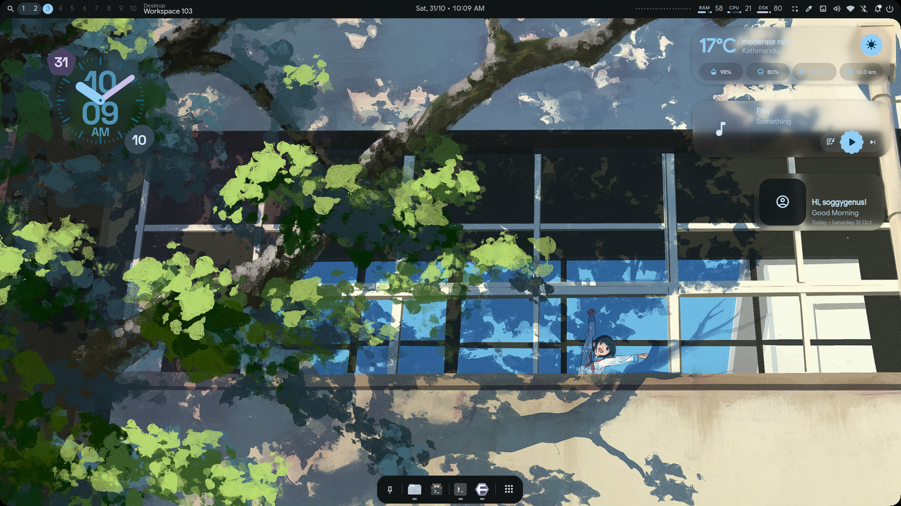
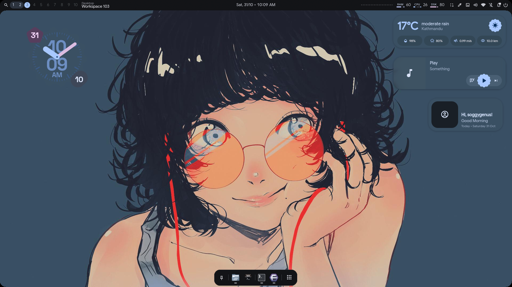

<div align="center">

# 💠 end4-pC

**A personal fork of [illogical-impulse](https://github.com/end-4/dots-hyprland) by [@end-4](https://github.com/end-4)**  
Customized and maintained by **pctrade**

[English](README.md) | [简体中文](README.zh-CN.md) | [日本語](README.ja.md)

</div>

---

## 🎬 Showcase

<p align="center">
  <a href="https://www.youtube.com/watch?v=o0Vsh7eVchs">
    
  </a>
</p>

</div>

---

## 📸 Screenshots
<div align="center">

| 🎵 Lyrics | 🖼️ Online Wallpapers |
|:---:|:---:|
|  |  |
| 🪟 Desktop Widgets | 🔧 Hyprland Configs |
|  |  |
| ⚙️ Configurable Bar | ✨ And More |
|  |  |

</div>

---

## 🎨 Community Presets

Share your whole desktop with one button, or try someone else's in a click.

**[end4-pCpresets](https://github.com/pctrade/end4-pCpresets)** is the community gallery for this shell. Open **Dashboard → Presets**, pick a preset and press **Download** to try it or **Install** to keep it. Made your own? Press **Upload**, choose a screenshot and it is sent for you with one click. The first time, a terminal opens to install the [GitHub CLI](https://cli.github.com) (`gh`) and sign you in, which takes a minute. If you skip that, the shell opens a GitHub page where you drag the folder in instead. Changed your mind? **Remove from gallery** takes your own preset back out.

- 🔒 **Private by design:** nothing is collected from you. The shell only reads public files from GitHub.
- 🧹 **Clean exports:** personal paths, keys and commands are removed before anything is shared.
- ✅ **Every preset is checked** automatically. First-time authors are reviewed by hand, and trusted authors are merged automatically once the check passes.
- 👤 **Yours stays yours:** only the person who shared a preset can change or remove it.

[Browse the gallery](https://github.com/pctrade/end4-pCpresets) · [How to share yours](https://github.com/pctrade/end4-pCpresets#share-your-preset)

---

## ⚡ Installation

> [!NOTE]
> This fork manages its own configuration folder independently — it does **not** overwrite or modify any existing setup. However, it does require [illogical-impulse](https://github.com/end-4/dots-hyprland) to be installed and running.

```bash
cd ~/.config/quickshell/
git clone https://github.com/pctrade/end4-pC.git
killall qs 2>/dev/null; qs -c end4-pC > /dev/null 2>&1 & disown
```

### 🔧 Set as your default shell (optional)

If you like it and want it to load by default instead of `ii`, edit:

```bash
~/.config/hypr/hyprland/variables.lua
```

And change this line:

```lua
hl.env("qsConfig", "ii")
```

to:

```lua
hl.env("qsConfig", "end4-pC")
```

> [!TIP]
> After saving, restart Hyprland or run `hyprctl reload` to apply the change.

---

#### Under MangoWM

Add the shell to `~/.config/mango/config.conf` (see
[`mango-keybinds.conf`](mango-keybinds.conf) for the keybinds and the
`source_optional` include):

```bash
exec_once=qs -c end4-pC

# at the END of the file, so the shell's options win over yours
source_optional=/home/<user>/.config/mango/qssettings/shell.conf
```

---

### ⚙️ Settings keybind

To open the settings panel, add this to your Hyprland config:

```lua
hl.bind("SUPER + escape", hl.dsp.global("quickshell:settingsToggle"), {description = "Toggle settings"})
```

> **Note:** Settings is an overlay panel, not a regular window — `Super + Q` won't close it. Use the same keybind to toggle it or press `Escape`.

---

## ❓ FAQ

### How do I see my keybinds?

Open the launcher (`SUPER`) and type `<` — it'll show you the full list of configured keybinds.

### Why doesn't Settings have a search bar?

It doesn't need one — the launcher already does that job. Open the launcher (`SUPER`) and just type what you're looking for (e.g. `wallpaper`, `bar`, `blur`); it'll match against page names and section keywords and jump you straight to the right Settings page, so there's no need for a separate search inside Settings itself.

---

## 🥭 MangoWM

This fork also runs on **MangoWM** (`mmsg` IPC). MangoWM is tag based, so the
shell exposes Mango's tags as workspaces and never touches your
`~/.config/mango/config.conf` unless you ask it to.

<div align="center">

| 🌿 Desktop & widgets | 🎧 More wallpapers |
|:---:|:---:|
|  |  |

</div>

### What runs under MangoWM

| Component | Notes |
|:---|:---|
| `services/WM.qml` | One compositor facade: `isHyprland` / `isNiri` / `isMango`, plus window, workspace, monitor and action proxies. Consumers never call a compositor API directly. |
| `services/MangoBackend.qml` | `mmsg` watch streams, normalised into Hyprland-shaped data. Tags become workspaces with ids `(monitorIndex + 1) * 100 + tagIndex`. |
| `services/MangoXkb.qml` + `services/Xkb.qml` | Keyboard layout, replacing the Hyprland-only indicator. |
| `services/Keybinds.qml` + `services/MangoKeybinds.qml` + `scripts/mango/` | Keybind parsing so launcher search still finds your binds. |
| Settings → Mango | Mango options are persisted in `~/.config/mango/qssettings/settings.json` and written to a generated `shell.conf` that your config includes via `source_optional`. Add the include line at the end of `config.conf` (the page's **Setup** button does it with a backup). |

### MangoWM keybinds

MangoWM has no global-shortcut protocol, so the shell is driven through IPC
instead of Hyprland bindings. Reference: [`mango-keybinds.conf`](mango-keybinds.conf).

```bash
bind=SUPER,d,spawn,qs -c end4-pC ipc call search toggle
bind=SUPER,w,spawn,qs -c end4-pC ipc call wallpaperSelector toggle
bind=SUPER,t,spawn,qs -c end4-pC ipc call search workspacesToggle
bind=NONE,XF86MonBrightnessUp,spawn,qs -c end4-pC ipc call brightness increment
bind=NONE,XF86MonBrightnessDown,spawn,qs -c end4-pC ipc call brightness decrement
bind=NONE,XF86AudioRaiseVolume,spawn_shell,wpctl set-volume -l 1 @DEFAULT_AUDIO_SINK@ 5%+
bind=NONE,XF86AudioLowerVolume,spawn_shell,wpctl set-volume @DEFAULT_AUDIO_SINK@ 5%-
bind=NONE,XF86AudioMute,spawn_shell,wpctl set-mute @DEFAULT_AUDIO_SINK@ toggle
```

Run `qs -c end4-pC ipc show` for every target the shell exposes.

### Where screenshots end up

| Tool | Path |
|:---|:---|
| Shell screen snip — Settings → Services → *Screenshot path* | unset means clipboard only; set it to `~/Pictures/Screenshots` |
| `flameshot` (`SUPER + O`) | `~/Pictures/Screenshots` |
| Captures used in the screenshots above | `~/Pictures/Screenshots/Screenshots` |
| Screen recordings | `~/Videos` |

---

## 🙏 Credits

Huge thanks to the people who made this possible:

- **[@end-4](https://github.com/end-4)** — for creating the original [dots-hyprland](https://github.com/end-4/dots-hyprland) / illogical-impulse shell. An absolute masterpiece of a dotfiles project 🫡
- **[@gh0stzk](https://github.com/gh0stzk)** — for providing the weather API integration that made the weather widget possible 🙌
- **[@StarS2112](https://github.com/StarS2112)** — for showcasing this fork 🙌
- **[@simeulinuxkaliaiwr](https://github.com/simeulinuxkaliaiwr)** — for some shader transitions 🎨

---

<div align="center">

Made with ❤️ — feel free to fork and make it your own

</div>
